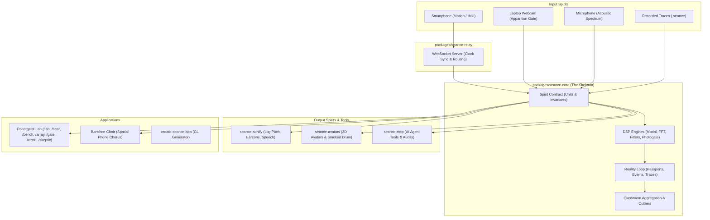

# Séance: Ghost Ear Lab 👻

> **The phone lab you can see, hear and trust.**  
> Any phone becomes a science instrument in five seconds. Blind students can run the whole experiment by ear. Every real measurement can become a test that keeps the software honest.

[](https://github.com/devprashant19/seance/actions/workflows/ci.yml)


---

## 🌟 Key Highlights

- **5-Second Zero-Install Setup**: Scan a QR code on your laptop screen. Your phone immediately connects over a lightweight WebSocket relay (`seance-relay`) and streams calibrated 60–100 Hz IMU sensor data.
- **Ghost Ear (Accessibility Mode — Study Pending)**: An accessible laboratory where blind and low-vision learners measure gravity, acoustic stiffness, and rotational dynamics by ear using log-pitch sonification, tilt-scrubbing, Android haptics, and spoken results with expanded units.
- **The Reality Loop**: Guided phone calibration rituals, automated device passports (`/bench`), and event-window extraction that turns real phone physical impacts into permanent regression tests.
- **Smoked-Drum Recorder**: A tactile, extremum-preserving `<canvas>` seismograph strip chart that tracks raw physical signals at 60 fps without masking micro-peaks or sensor dropouts.
- **Spirit Array**: Synchronize 2 to 6 phones on a plank or coupled pendulum to measure modal resonance shapes, beat frequencies, and strict clock skew uncertainty bounds ($\Delta t_{skew} \ge \frac{1}{2}\min(RTT)$).
- **Apparition Gate**: A contactless optical photogate and stroboscopic tachometer running **100% laptop-only** with your webcam. Detects pendulum periods, roll speeds, and flags Nyquist aliasing.
- **Séance Circle (Classroom Mode)**: One or two phones serve an entire classroom. Live team dot plots with error bars, inverse-variance weighted consensus ($1/\sigma^2$), and non-censored outlier detection ($|x - \text{med}| > 3\cdot\text{MAD}$).
- **Skeptic's Séance**: A critical-thinking environmental audit inspecting 1–20 Hz infrasound and rolling-shutter mains light flicker, guarded by an automated `ClaimGuard` blocking pseudoscience.

---

## 🏗️ Architecture



---

## 📦 Monorepo Workspace

| Package / App | Description |
|---|---|
| [`packages/seance-core`](packages/seance-core) | Core skeleton: `Spirit` contracts, unit system, robust DSP, photogates, reality loop, passports, array sync, and classroom statistics. |
| [`packages/seance-sonify`](packages/seance-sonify) | Auditory display engine: continuous log-pitch mapping, acoustic earcons, speech synthesis, and scrub-by-tilt. |
| [`packages/seance-avatars`](packages/seance-avatars) | 3D/2D spiritual avatars, mood health monitoring, and the Smoked Drum seismograph. |
| [`packages/seance-relay`](packages/seance-relay) | Low-latency room server with sub-millisecond clock synchronization and role management. |
| [`packages/seance-mcp`](packages/seance-mcp) | Model Context Protocol server exposing real device traces, passports, and sonification audits to AI assistants. |
| [`packages/create-seance-app`](packages/create-seance-app) | Scaffolding CLI with starter templates (`lab`, `ghost-ear`, `array`). |
| [`apps/poltergeist-lab`](apps/poltergeist-lab) | The main scientific playground: Ghost Ear, WraithBench, Spirit Array, Apparition Gate, Circle, and Skeptic. |
| [`apps/banshee-choir`](apps/banshee-choir) | Multi-device interactive spatial sound synthesis experiment. |

---

## 🚀 Quickstart

### Prerequisites
- Node.js >= 18
- pnpm >= 8 (`corepack enable`)

### 1. Run Local Dev Server
```bash
# Clone and install dependencies
git clone https://github.com/devprashant19/seance.git
cd seance
pnpm install

# Build core packages
pnpm --filter seance-core build
pnpm --filter seance-sonify build
pnpm --filter seance-mcp build

# Start relay server (Terminal 1)
pnpm dev:relay

# Start Poltergeist Lab (Terminal 2)
pnpm -F poltergeist-lab dev
```

### 2. Connect Your Phone
1. Open `http://localhost:5173` on your laptop.
2. Scan the on-screen QR code with your phone camera, or open the link directly on your phone.
3. Tap **Begin Possession** on your phone to stream motion data.

### 3. Laptop-Only Path (No Phone Required!)
No phone available? You can explore every feature directly:
- **Apparition Gate** (`/gate`): Uses your laptop webcam as an optical photogate and tachometer.
- **The Singing Ruler** (`/lab/singing-ruler`): Uses your laptop microphone to measure Young's modulus.
- **Recorded Hauntings** (`/replay`): Replay real physical `.seance` traces collected from iPhones and Pixels.
- **Skeptic's Séance** (`/skeptic`): Inspect room lighting and environmental floor vibrations with ClaimGuard.

---

## 🧩 Adding a New Experiment in 4 Files

Séance makes adding new physics experiments declarative:

1. **`src/experiments/<id>/theory.ts`**: Pure physics equations and analytical derivations.
2. **`src/experiments/<id>/uncertainty.ts`**: Pure Gaussian error propagation formulas.
3. **`src/experiments/<id>/analysis.ts`**: Signal extraction algorithms returning measured quantities and error bounds.
4. **`src/experiments/<id>/index.ts`**: Declarative definition registering inputs, channels, and safety notes with `defineExperiment()`.

---

## ♿ Accessibility Statement

The **Ghost Ear** accessible laboratory was designed in alignment with empirical co-design principles for blind and low-vision learners:
- **Zero Visual Dependence**: Every phase of an experiment (readiness, start, peaks, impact, and completion) is rendered through distinct acoustic earcons and log-frequency pitches.
- **Tilt-to-Scrub**: Users tilt the phone backwards and forwards to scrub across time and hear turning points.
- **Spoken Uncertainties**: Quantities are articulated using standard speech synthesis with expanded units (`"9.81 plus or minus 0.04 meters per second squared"`).
- **Darkroom Mode**: High-contrast, pure-black theme with zero extraneous glare for light-sensitive or low-vision users.
- **Empirical Study Protocol**: Documented in [`docs/studies/ghost-ear-study.md`](docs/studies/ghost-ear-study.md) and [`docs/evidence/study-summary.md`](docs/evidence/study-summary.md).

---

## 🛡️ Ground Rules & Ethical Claims

1. **No Fake Numbers**: All benchmarks and numbers in documentation are real and measured. Unmeasured parameters are explicitly tagged `not measured`.
2. **Units & Uncertainties**: Every physical quantity has an explicit SI unit and uncertainty bound ($x \pm \delta x$).
3. **Claim Guard**: Automated static and runtime validation blocks claims of supernatural detection, unverified accessibility certifications, and medical diagnostics.
4. **Pure Maths in Packages**: React components only render; all mathematical equations reside in pure, property-tested functions in `packages/`.

---

## 👥 Contributors & Acknowledgements

Created for Kiroween 2026 by the **Skeleton Crew**. Built with Vite, React, Vitest, Fast-Check, and the Model Context Protocol (MCP).
